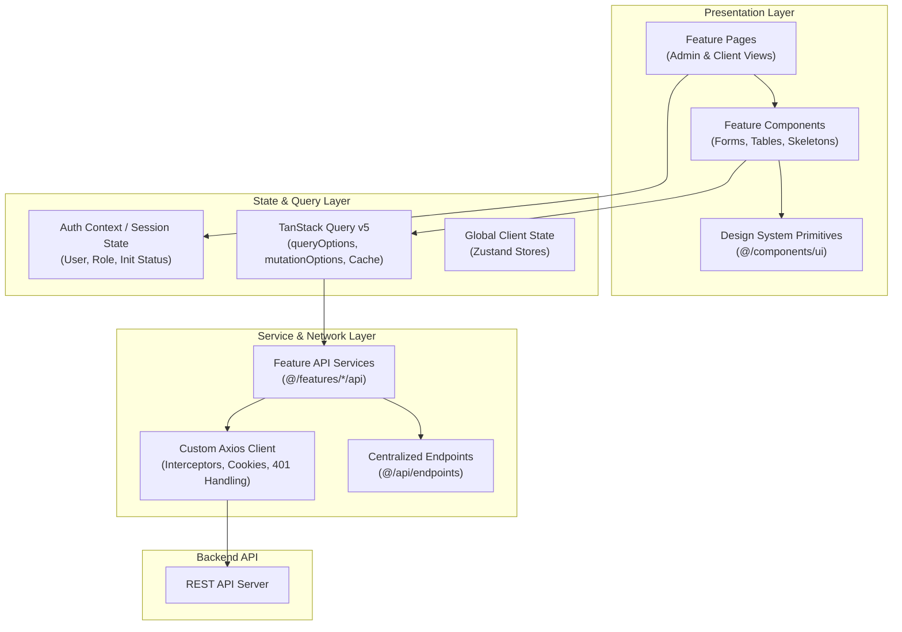
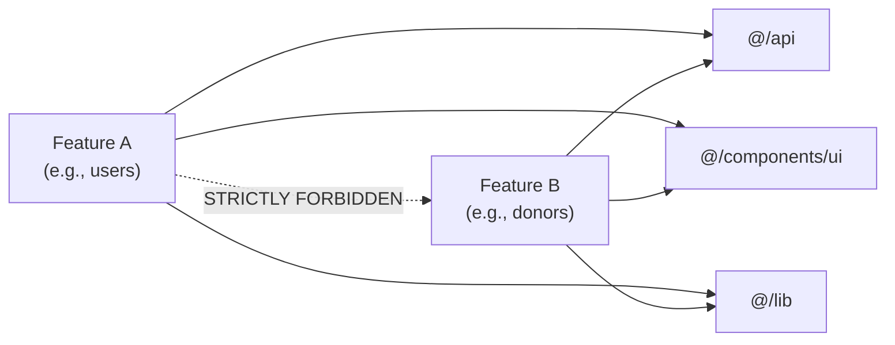
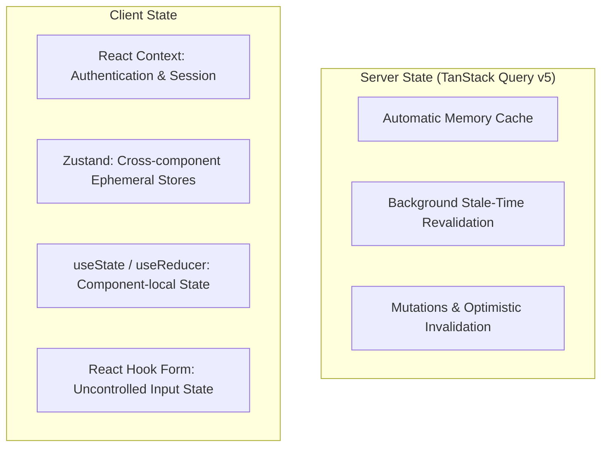
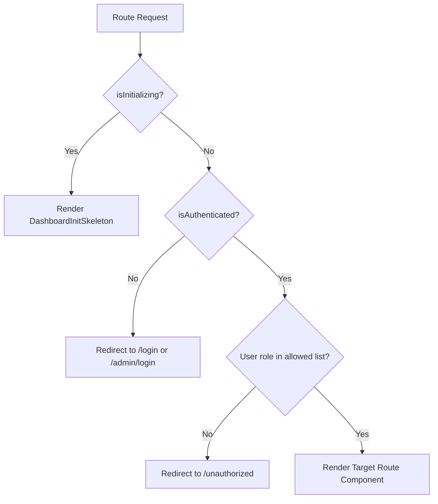

# BDMS React Frontend Architecture Guide

This document provides a comprehensive overview of the **Blood Donation Management System (BDMS)** frontend architecture, detailing the architectural paradigms, technology stack, directory organization, feature modularization, data flow, state management, and routing/RBAC patterns.

---

## Table of Contents

1. [Architectural Overview & Core Philosophy](#1-architectural-overview--core-philosophy)
2. [Technology Stack & Libraries](#2-technology-stack--libraries)
3. [Folder Structure & Separation of Concerns](#3-folder-structure--separation-of-concerns)
4. [Feature-Sliced Modular Architecture](#4-feature-sliced-modular-architecture)
5. [Data Flow & API Communication Layer](#5-data-flow--api-communication-layer)
6. [State Management Strategy](#6-state-management-strategy)
7. [Routing & Role-Based Access Control (RBAC)](#7-routing--role-based-access-control-rbac)
8. [Design System & UI Component Architecture](#8-design-system--ui-component-architecture)
9. [Development Conventions & Best Practices](#9-development-conventions--best-practices)

---

## 1. Architectural Overview & Core Philosophy

The BDMS frontend is built on a **Domain-Driven, Feature-Based Modular Architecture** (similar to Feature-Sliced Design principles). Instead of grouping files purely by technical type (e.g., throwing all components, hooks, and services into giant global folders), code is grouped by **business domain / feature capability**.



### Core Architectural Principles

1. **Feature Encapsulation**: A feature module contains everything required to implement its slice of business logic: dedicated API functions, query hooks, UI components, page views, route definitions, and TypeScript interfaces.
2. **Strict Boundary Control**: Feature modules are self-contained and decoupled. Features never cross-import directly from peer features; shared dependencies reside in global modules (`@/components/ui`, `@/api`, `@/lib`, `@/layouts`, `@/context`).
3. **Layered Separation of Concerns**:
   - **Presentation**: Dumb/stateless UI primitives (`@/components/ui`) and feature-specific smart forms/tables.
   - **Orchestration**: Pages that bind layouts, trigger queries, and coordinate feature sub-components.
   - **Data Fetching & Cache**: TanStack Query key factories and query options (`@/features/*/queries`).
   - **Network**: Pure HTTP service abstractions (`@/features/*/api`) utilizing a shared Axios instance.
4. **Type-Driven Contract Safety**: TypeScript strictly defines payloads, API responses, query arguments, form models, and access control roles across the entire lifecycle.

---

## 2. Technology Stack & Libraries

The system is constructed with modern React ecosystem tooling, prioritizing performance, strict typing, developer ergonomics, and user experience.

### 2.1 Core Framework & Runtime

| Library | Version | Role & Purpose |
| :--- | :--- | :--- |
| **React** | `^19.2.0` | Latest concurrent UI framework utilizing modern hooks, performance optimizations, and React 19 features. |
| **React DOM** | `^19.2.0` | DOM bindings for client-side rendering. |
| **TypeScript** | `~5.9.3` | End-to-end static typing, interface contracts, strict null-checks, and intellisense across features. |
| **Vite** | `^7.3.1` | Next-generation build tool featuring lightning-fast Hot Module Replacement (HMR) and optimized Rollup production bundling. |

### 2.2 Routing & Navigation

| Library | Version | Role & Purpose |
| :--- | :--- | :--- |
| **React Router DOM** | `^7.13.1` | Client-side routing engine using the modern Data Router architecture (`createBrowserRouter`, `<RouterProvider />`). Supports nested routes, layout sharing, dynamic path params, and route error boundaries. |

### 2.3 Server State & Network Communication

| Library | Version | Role & Purpose |
| :--- | :--- | :--- |
| **@tanstack/react-query** | `^5.95.2` | Powerful asynchronous server-state management. Eliminates boilerplate `useEffect` fetching with automatic background revalidation, stale-time caching, query key factories, and `queryOptions` / `mutationOptions` factories. |
| **axios** | `^1.13.6` | Promise-based HTTP client preconfigured with credentials (`withCredentials: true`), centralized base URLs, headers, and response interceptors (e.g. automated 401 session expiration handling). |
| **@tanstack/eslint-plugin-query** | `^5.91.4` | Linter plugin enforcing React Query best practices and avoiding hook dependency pitfalls. |

### 2.4 UI Component Foundation & Styling

| Library | Version | Role & Purpose |
| :--- | :--- | :--- |
| **Tailwind CSS** | `^4.2.1` | Modern utility-first CSS engine configured via `@tailwindcss/vite` for streamlined, ultra-fast builds without heavy postCSS configuration. |
| **Radix UI Primitives** | `^1.4.3` | Unstyled, accessible (WAI-ARIA compliant) headless primitives powering dialogs, dropdowns, radio groups, checkboxes, and popovers. |
| **shadcn** | `^3.8.5` | Code-distribution design system convention providing adaptable components directly in `src/components/ui/`. |
| **class-variance-authority** (`cva`) | `^0.7.1` | Type-safe declarative variant management for component states, sizes, and color themes. |
| **clsx** & **tailwind-merge** | `^2.1.1` / `^3.5.0` | Utility helpers combined into the `cn(...)` function to dynamically merge Tailwind classes without specificity collision. |
| **lucide-react** | `^0.576.0` | Crisp, tree-shakeable SVG icon collection consistent across the entire admin and client interfaces. |
| **next-themes** | `^0.4.6` | System/light/dark theme toggling and local persistence. |
| **tw-animate-css** | `^1.4.0` | Animation utilities for smooth dialog, popover, and dropdown transitions. |

### 2.5 Form Architecture & Schema Validation

| Library | Version | Role & Purpose |
| :--- | :--- | :--- |
| **react-hook-form** | `^7.72.0` | Uncontrolled form state manager that drastically reduces unnecessary component re-renders during high-frequency user input. |
| **zod** | `^4.3.6` | Declarative, TypeScript-first schema declaration and runtime validation library. |
| **@hookform/resolvers** | `^5.2.2` | Integrates Zod validation schemas seamlessly into `react-hook-form`, enabling automatic field error reporting. |

### 2.6 Data Tables & Rich Content

| Library | Version | Role & Purpose |
| :--- | :--- | :--- |
| **@tanstack/react-table** | `^8.21.3` | Headless data grid manager handling sorting, client/server pagination, row selection, and column filtering for administrative donor, user, and inventory tables. |
| **@tinymce/tinymce-react** & **tinymce** | `^6.3.0` / `^8.4.0` | Production WYSIWYG rich text editor for publishing and managing formatted hospital announcements and medical newsletters. |

### 2.7 Utilities & Client State

| Library | Version | Role & Purpose |
| :--- | :--- | :--- |
| **zustand** | `^5.0.12` | Minimal, boilerplate-free store for complex client-only state requiring cross-component reactivity outside React Context. |
| **date-fns** | `^4.1.0` | Modern, tree-shakeable date formatting, relative time calculation, and date arithmetic. |
| **sonner** | `^2.0.7` | Opinionated, accessible, high-performance toast notification system for feedback on queries and mutations. |

---

## 3. Folder Structure & Separation of Concerns

The workspace isolates system-level responsibilities from domain features:

```
src/
├── api/                  # Centralized HTTP client, configuration, and endpoint registries
├── components/           # Shared, domain-agnostic UI and layout building blocks
│   ├── footer/           # Global footer components
│   ├── nav/              # Global navigation components
│   └── ui/               # Design system primitives (buttons, dialogs, inputs, tables)
├── context/              # Global React contexts (Auth, session bootstrap)
├── features/             # Self-contained business domain modules (Feature-Sliced)
├── layouts/              # Route shell layouts (Guest, Dashboard, Auth)
├── lib/                  # Framework-agnostic utilities, icons, and helper libraries
├── pages/                # Generic fallback and HTTP error pages (404, 403, 500)
├── App.tsx               # Root application router provider
├── main.tsx              # DOM entry point, Providers configuration (QueryClient, Auth)
├── query-client.ts       # Shared TanStack QueryClient instance and default cache policies
├── router.tsx            # Global centralized React Router definition
├── fonts.css             # Custom typography imports
└── index.css             # Tailwind v4 directives and CSS variable design tokens
```

### Detailed Folder Responsibilities

### 📁 `src/api`
Houses global networking abstractions.
- **`axios-client.ts`**: The shared `axios` instance configured with `VITE_API_BASE_URL`, default timeouts (10s), JSON headers, credentials (`withCredentials: true`), and response interceptors that intercept `401 Unauthorized` responses to purge query cache and redirect users to login.
- **`endpoints/`**: Holds typed endpoint constants organized by domain (e.g. `user.endpoints.ts`, `blood-inventory.endpoints.ts`, `donation.endpoints.ts`). Keeping string URLs in one place prevents typos and makes backend URL changes trivial to refactor.

### 📁 `src/components`
Contains shared, domain-agnostic UI elements that know nothing about blood donations, donors, or appointments.
- **`ui/`**: Atomic components based on Radix UI and styled with Tailwind (e.g. `button.tsx`, `dialog.tsx`, `input.tsx`, `table.tsx`, `badge.tsx`, `date-picker.tsx`, `sonner.tsx`).
- **Shared Skeletons**: Generic loading states like `table-skeleton.tsx`, `sidebar-skeleton.tsx`, and `dashboard-nav-skeleton.tsx`.
- **Layout primitives**: `container.tsx`, `section.tsx`.

### 📁 `src/context`
Houses application-wide React contexts that must wrap large subtrees.
- **`context/auth/`**:
  - `auth-context.tsx`: Context contract (`user`, `isAuthenticated`, `isInitializing`, `login`, `logout`).
  - `auth-provider.tsx`: Context implementation syncing auth session state with TanStack Query (`authKeys.me()`).
  - `useAuth.tsx`: Custom ergonomic hook consuming the auth context.

### 📁 `src/layouts`
Top-level layout shells that host nested child routes via `<Outlet />`.
- **`guest-layout.tsx`**: Public-facing header, footer, and navigation bar for unauthenticated landing pages and announcements.
- **`dashboard-layout.tsx`**: Authenticated administrative/client shell managing mobile-responsive sidebar toggling (`dashboard-sidebar.tsx`), top navigation (`dashboard-nav.tsx`), notifications (`<Toaster />`), and main content container.
- **`auth-layout.tsx`**: Minimal centered layout for login, registration, and password recovery pages.

### 📁 `src/lib`
Pure utility functions, formatters, and icons.
- **`utils.ts`**: Contains the standard `cn(...inputs: ClassValue[])` helper combining `clsx` and `tailwind-merge`.
- **`dashboard-icons.tsx`**: Centralized mapping of icons to navigation routes.

### 📁 `src/pages`
Global system-level fallback pages independent of any feature domain:
- `not-found-page.tsx`: Standard 404 handler.
- `forbidden-page.tsx`: 403 Forbidden handler when an authenticated user lacks the required role.
- `error-page.tsx`: Top-level route error boundary for uncaught exceptions.

---

## 4. Feature-Sliced Modular Architecture

The `src/features/` folder is the core of the application. Each business domain is treated as an autonomous, self-contained package.

### Active Feature Modules

| Feature Module | Domain Responsibility |
| :--- | :--- |
| **`admin-dashboard`** | Administrative metrics, blood unit summaries, donation trends, analytical charts. |
| **`announcements`** | Public and internal blood donation campaigns, news alerts, RichText TinyMCE editor. |
| **`appointments`** | Appointment scheduling, slot booking, verification, donor appointment calendars. |
| **`auth`** | Authentication credentials, login, registration, password management, session verification. |
| **`blood-inventories`** | Blood bank stock levels by blood group (A+, B-, O+, etc.), expiration dates, cold chain logs. |
| **`blood-requests` / `requests`** | Emergency and hospital blood requests, urgency levels, request fulfillment workflows. |
| **`certificates`** | Donor appreciation certificates, PDF download/rendering, verification barcodes. |
| **`client-dashboard`** | Donor portal overview, personal donation history, eligibility status, upcoming appointments. |
| **`donations`** | Actual donation records, units collected, physical exam logs, collection statuses. |
| **`donors`** | Donor profiles, medical eligibility criteria, blood types, contact details. |
| **`home`** | Public landing page, stats counters, call-to-action sections, blood drive search. |
| **`hospitals`** | Partner hospitals, blood distribution targets, requisition endpoints. |
| **`medical-records`** | Pre-donation screening records, hemoglobin measurements, pulse/BP logs, eligibility notes. |
| **`roles`** | Role definitions, permissions mapping, administrative system settings. |
| **`users`** | Internal user accounts, staff management, account activation/deactivation, profile editing. |

### Anatomy of a Feature Module

Every feature follows a standardized internal directory structure (exemplified by `src/features/users/`):

```
features/users/
├── api/
│   └── user.api.ts              # Pure async API calls using Axios
├── components/
│   ├── user-create-form.tsx     # Feature-specific form (React Hook Form + Zod)
│   ├── user-edit-form.tsx       # Feature-specific edit form
│   ├── user-detail-table.tsx    # Info presentation component
│   ├── table/                   # TanStack Data Table components
│   │   ├── user-columns.tsx     # Column definitions (ColumnDef<User>)
│   │   └── user-data-table.tsx  # Table instance, sorting, pagination UI
│   └── ui/                      # Feature-specific skeletons & badges
│       ├── user-form-skeleton.tsx
│       └── user-detail-skeleton.tsx
├── pages/                       # Page-level route views
│   ├── user-list.tsx            # View rendering user table and query data
│   ├── user-create.tsx          # View for user creation
│   ├── user-edit.tsx            # View for editing an existing user
│   ├── user-detail.tsx          # Detailed view of a single user
│   ├── user-error.tsx           # Feature-level error boundary
│   └── profile-page.tsx         # User profile settings view
├── queries/                     # TanStack Query logic
│   ├── index.ts                 # Clean export surface
│   ├── userKeys.ts              # Hierarchical Query Key factory
│   └── userQueries.ts           # queryOptions & mutationOptions declarations
├── user.routes.tsx              # Feature route tree definitions
└── user.types.ts                # TypeScript types, DTOs, and schema interfaces
```

#### Multi-Audience Features (`admin` vs `client`)
When a feature serves both administration staff and regular clients/donors (e.g. `appointments`, `certificates`, `donations`, `requests`), its `pages` folder is cleanly split:

```
features/appointments/pages/
├── admin/                       # Staff management, approvals, slot creation
│   ├── appointment-admin-list.tsx
│   └── appointment-status-update.tsx
└── client/                      # Donor view, personal bookings
    ├── appointment-booking.tsx
    └── client-appointment-history.tsx
```

### Feature Communication Rules



- **Forbidden**: Importing directly across features (e.g., `import { ... } from "@/features/donors/..."` inside `features/users`).
- **Permitted**: If two features need the exact same type or utility, it is extracted to `@/lib` or a top-level shared module.

---

## 5. Data Flow & API Communication Layer

Data retrieval and server synchronization follow a strict unidirectional pipeline:

```
[UI Component / Page]
         │
         ▼
[TanStack Query Hook / queryOptions]
         │
         ▼
[Feature API Service: user.api.ts]
         │
         ▼
[Endpoints Dictionary: user.endpoints.ts]
         │
         ▼
[Global Axios Client: axios-client.ts]
         │ (Headers, Cookies, Interceptors)
         ▼
[Backend REST API Server]
```

### 1. Endpoints Layer (`@/api/endpoints`)
URLs are stored as constants with parameter builders:
```ts
export const USER_ENDPOINTS = {
  LIST: "/User/list",
  CREATE: "/User/create",
  UPDATE: "/User/update",
  DELETE: (id: string | number) => `/User/delete/${id}`,
  GET_BY_ID: (id: string | number) => `/User/${id}`,
  UPDATE_STATUS: (id: string | number) => `/User/${id}/status`,
} as const;
```

### 2. Feature API Layer (`@/features/*/api`)
Functions make asynchronous HTTP calls and return typed promises:
```ts
export const getUsers = async (): Promise<User[]> => {
  const response = await api.get<User[]>(USER_ENDPOINTS.LIST);
  return response.data;
};
```

### 3. Query Key Factory Pattern (`@/features/*/queries/*Keys.ts`)
Standardized array keys enable surgical cache invalidation:
```ts
export const userKeys = {
  all: ["users"] as const,
  list: () => [...userKeys.all] as const,
  detail: (id: number) => [...userKeys.all, "detail", id] as const,
};
```

### 4. Modern Query/Mutation Options (`@/features/*/queries/*Queries.ts`)
Using TanStack Query v5 `queryOptions` and `mutationOptions`:
```ts
export const getUsersQueryOptions = queryOptions<User[]>({
  queryKey: userKeys.list(),
  queryFn: getUsers,
});

export const getUserQueryOptions = (id: number) => queryOptions<User>({
  queryKey: userKeys.detail(id),
  queryFn: () => getUser(id),
});
```

---

## 6. State Management Strategy

The frontend clearly separates **Server State** from **Client State**:



1. **Server State (TanStack Query v5)**:
   - All external data (users, donors, blood stock levels, appointments) is considered cached server state.
   - Handled exclusively via TanStack Query, eliminating manual synchronization bugs.
   - Mutation lifecycles automatically invalidate matching `queryKey` trees on success.
2. **Global Auth State (React Context)**:
   - `AuthContext` provides the active user profile, authentication status (`isAuthenticated`), and initialization state (`isInitializing`).
   - Sits at the root of the React tree (`src/main.tsx`).
3. **Complex Cross-Component Client State (Zustand)**:
   - Available for UI flows spanning multiple un-nested components (e.g., complex multi-step donation wizards or drawer filters).
4. **Form State (React Hook Form)**:
   - High-speed, isolated form state managed through uncontrolled inputs and evaluated against Zod schemas.

---

## 7. Routing & Role-Based Access Control (RBAC)

Routing is centralized in `src/router.tsx` using React Router v7's `createBrowserRouter`.

### Route Organization

```
/ (Root)
│
├── Public Routes (GuestLayout)
│   ├── /                         # Landing page
│   ├── /announcements            # Public announcements & blood drive notices
│   └── /ui                       # Design system showcase (dev only)
│
├── Auth Routes (AuthLayout)
│   ├── /login                    # Client/donor login
│   ├── /admin/login              # Staff/admin portal login
│   ├── /register                 # Donor registration
│   └── /forgot-password
│
├── Client Portal (/client - ProtectedRoute: ['user'])
│   ├── /client                   # Donor personal dashboard
│   ├── /client/requests          # Personal blood requests
│   ├── /client/appointments      # My scheduled appointments
│   ├── /client/certificates      # My blood donation certificates
│   └── /client/profile           # Personal profile settings
│
└── Admin Portal (/admin - ProtectedRoute: ['admin', 'staff'])
    ├── /admin                    # Main administrative dashboard
    ├── /admin/users              # User management (CRUD, status toggle)
    ├── /admin/donors             # Donor database & records
    ├── /admin/blood-inventories  # Blood bank stock monitoring
    ├── /admin/donations          # Donation intake & logs
    ├── /admin/requests           # Incoming hospital blood requisitions
    ├── /admin/appointments       # Appointment calendars & scheduling
    ├── /admin/certificates       # Certificate issuance
    ├── /admin/medical-records    # Pre-screening & physical tests
    └── /admin/settings           # System permissions & settings (admin only)
```

### RBAC Implementation (`ProtectedRoute`)

Route access is enforced via the `<ProtectedRoute />` wrapper:



- **Authentication Guard**: Unauthenticated users are redirected to the appropriate login page based on the required role (`/admin/login` for administrative routes, `/login` for donor routes).
- **Authorization Guard**: If an authenticated user's `roleName` does not match the route's `allowed` array (e.g. a `user` attempting to visit `/admin/users`), they are immediately redirected to `/unauthorized`.
- **Loading Guard**: During session bootstrap (`isInitializing`), a full-fidelity skeleton layout (`DashboardInitSkeleton`) prevents screen flicker and redirect loops.

---

## 8. Design System & UI Component Architecture

The presentation layer is structured using the **shadcn/ui** philosophy: copyable, modifiable, un-opinionated primitives located directly in `src/components/ui`.

### Styling Foundation
- **Tailwind CSS v4**: Built-in CSS variables define semantic colors (`--background`, `--foreground`, `--primary`, `--muted`, `--border`, `--destructive`).
- **Class Merging (`cn`)**:
  ```ts
  import { clsx, type ClassValue } from "clsx";
  import { twMerge } from "tailwind-merge";

  export function cn(...inputs: ClassValue[]) {
    return twMerge(clsx(inputs));
  }
  ```
- **Variants via `cva`**: Components leverage `class-variance-authority` for strongly-typed states and sizes:
  ```ts
  export const buttonVariants = cva(
    "inline-flex items-center justify-center rounded-md text-sm font-medium transition-colors ...",
    {
      variants: {
        variant: {
          default: "bg-primary text-primary-foreground hover:bg-primary/90",
          destructive: "bg-destructive text-destructive-foreground hover:bg-destructive/90",
          outline: "border border-input bg-background hover:bg-accent",
          secondary: "bg-secondary text-secondary-foreground hover:bg-secondary/80",
          ghost: "hover:bg-accent hover:text-accent-foreground",
          link: "text-primary underline-offset-4 hover:underline",
        },
        size: {
          default: "h-9 px-4 py-2",
          sm: "h-8 rounded-md px-3 text-xs",
          lg: "h-10 rounded-md px-8",
          icon: "h-9 w-9",
        },
      },
      defaultVariants: {
        variant: "default",
        size: "default",
      },
    }
  );
  ```

### Data Grid Pattern (`@tanstack/react-table`)
Tables in features like `users`, `donors`, and `medical-records` separate columns from table rendering:
- `user-columns.tsx`: Pure column definitions implementing sort buttons, badges, and action dropdowns.
- `user-data-table.tsx`: The generic table shell supporting pagination controls, search input filtering, and loading state skeletons.

---

## 9. Development Conventions & Best Practices

1. **Path Aliasing**:
   Always use the `@/` alias configured in `tsconfig.json` and `vite.config.ts` to reference internal files (e.g. `@/components/ui/button`, `@/features/auth/useAuth`). Never use fragile relative paths like `../../components`.
2. **File & Directory Naming**:
   - Folders: `kebab-case` (e.g., `blood-inventories`, `medical-records`).
   - Component & Page files: `kebab-case.tsx` (e.g., `user-create-form.tsx`, `appointment-list.tsx`).
   - Hooks: `camelCase.ts` or `camelCase.tsx` (e.g., `useAuth.tsx`).
   - Types & API files: `[name].types.ts`, `[name].api.ts`, `[name].routes.tsx`.
3. **Strict Feature Encapsulation**:
   Never import from a sibling feature directory. If functionality is needed in multiple features, hoist it to `src/components/`, `src/api/`, `src/lib/`, or `src/context/`.
4. **Form Validation**:
   Always validate forms using Zod schemas paired with `react-hook-form` via `@hookform/resolvers/zod`. Do not store uncontrolled form values in global state.
5. **Mutation Feedback**:
   Trigger `sonner` notifications (`toast.success(...)`, `toast.error(...)`) inside mutation callbacks to give users instantaneous visual feedback on network operations.
